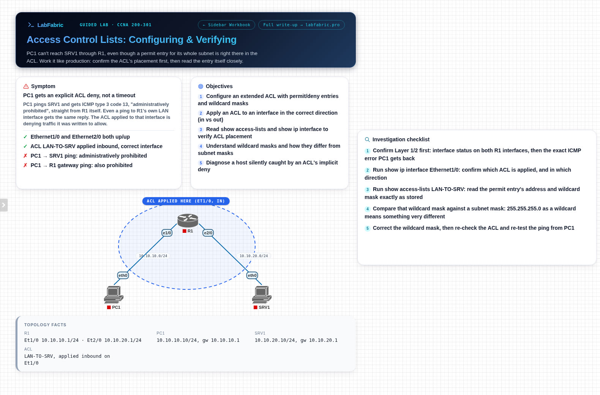
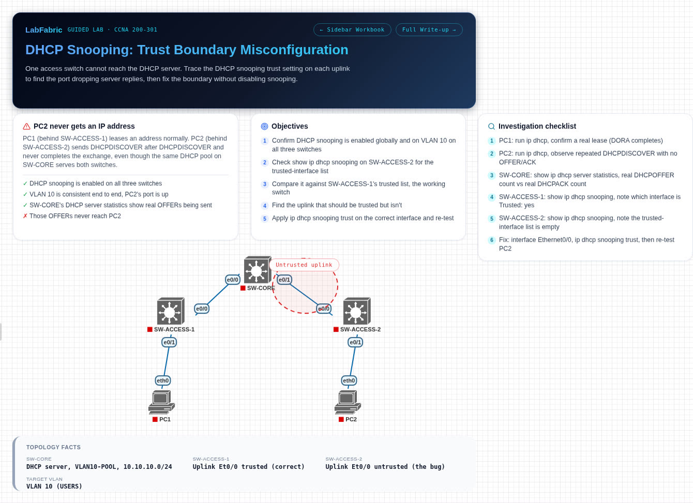
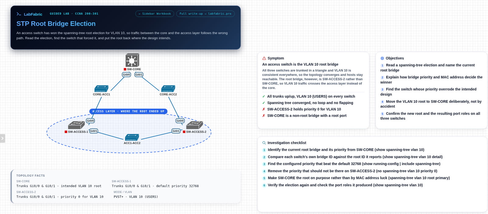
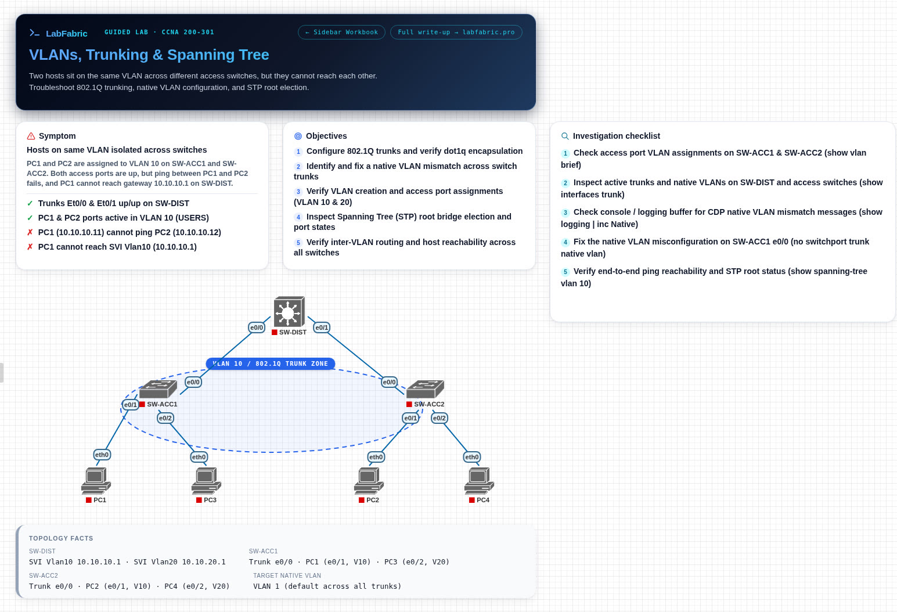
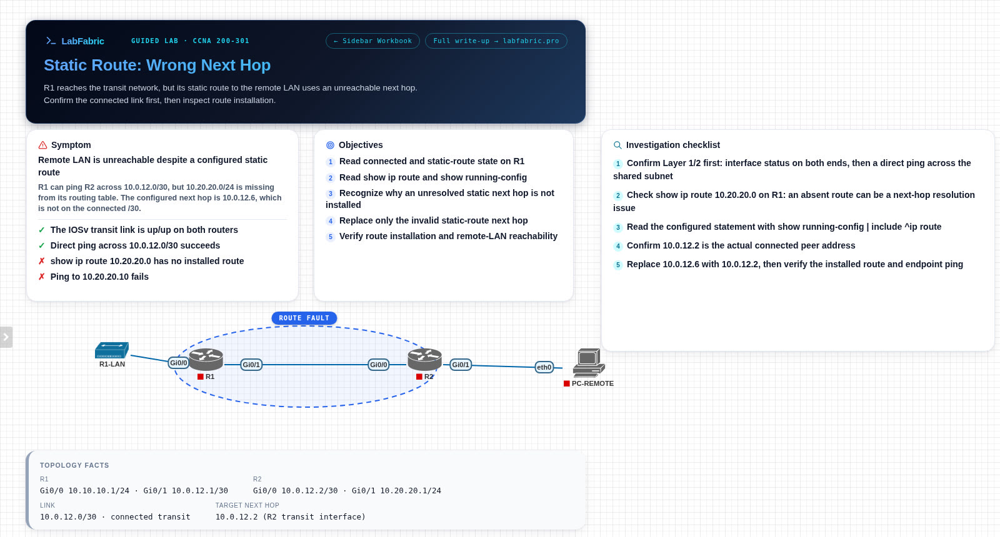
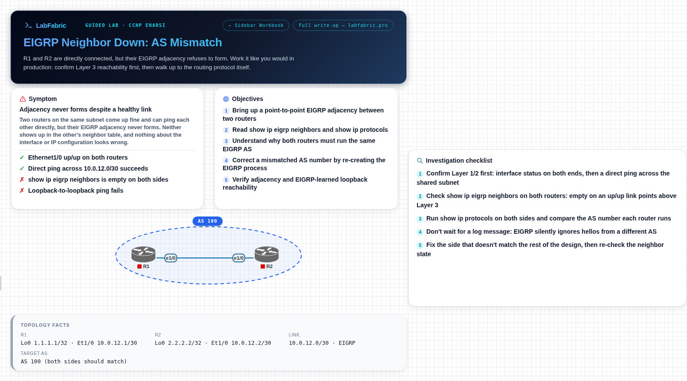
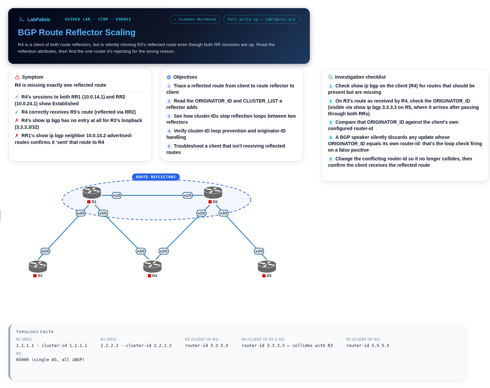
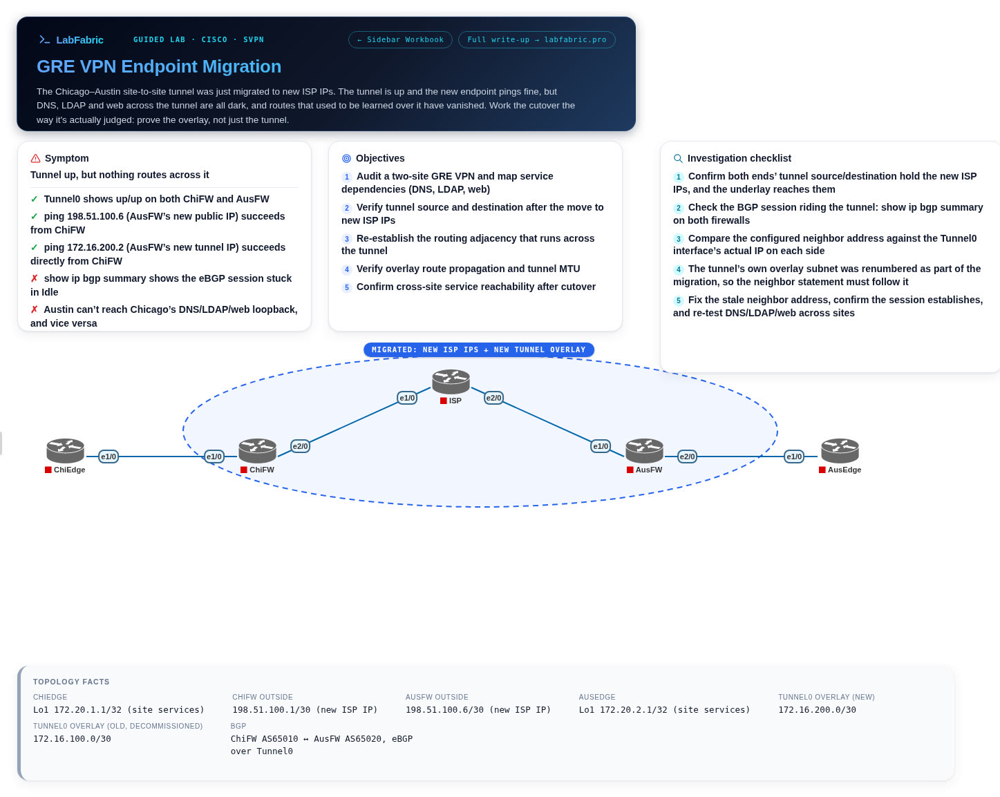

# Free EVE-NG and PNETLab labs (.unl)

10 free CCNA and CCNP troubleshooting labs for your own EVE-NG or PNETLab server. Each lab is a broken network to fix, packaged as a `.unl` file with faulted startup configs, canvas notes and a step-by-step walkthrough workbook.

Made by [LabFabric](https://labfabric.pro?utm_source=github&utm_medium=referral&utm_campaign=eve-ng-pnetlab-labs). Every lab also runs in your browser as a guided lab, no server needed.

## CCNA

| | Lab |
|---|---|
| <a href="labs/ospf-neighbor-area-mismatch-lab"></a> | **[OSPF Neighbor Down: Area Mismatch](labs/ospf-neighbor-area-mismatch-lab)**<br>Two routers share a working /30 link, but their OSPF adjacency never forms. Work up from Layer 3 to find out why.<br><sub>CCNA · 200-301 · IOL L3 · 51 KB · [Download](https://labfabric.pro/free-labs/ospf-neighbor-area-mismatch-lab?utm_source=github&utm_medium=referral&utm_campaign=eve-ng-pnetlab-labs)</sub> |
| <a href="labs/access-control-lists-lab"></a> | **[Access Control Lists: Configuring & Verifying](labs/access-control-lists-lab)**<br>PC1 pings a server through R1 and gets an explicit deny back, even though the ACL looks like it permits PC1's subnet. Find out what the router actually stored.<br><sub>CCNA · 200-301 · IOL L3 · 49 KB · [Download](https://labfabric.pro/free-labs/access-control-lists-lab?utm_source=github&utm_medium=referral&utm_campaign=eve-ng-pnetlab-labs)</sub> |
| <a href="labs/dhcp-snooping-lab"></a> | **[DHCP Snooping: Trust Boundary Misconfiguration](labs/dhcp-snooping-lab)**<br>Three switches run DHCP snooping. PC1 gets a lease, PC2 never does. Trace the trust boundary to the port dropping the server's replies.<br><sub>CCNA · 200-301 · IOL L2 · 45 KB · [Download](https://labfabric.pro/free-labs/dhcp-snooping-lab?utm_source=github&utm_medium=referral&utm_campaign=eve-ng-pnetlab-labs)</sub> |
| <a href="labs/spanning-tree-root-bridge-lab"></a> | **[Spanning Tree: Root Bridge Election](labs/spanning-tree-root-bridge-lab)**<br>Three switches in a triangle, and an access switch has won the VLAN 10 root bridge election. Find out why, then move the root to the core.<br><sub>CCNA · 200-301 · vIOS-L2 · 50 KB · [Download](https://labfabric.pro/free-labs/spanning-tree-root-bridge-lab?utm_source=github&utm_medium=referral&utm_campaign=eve-ng-pnetlab-labs)</sub> |
| <a href="labs/vlans-trunking-spanning-tree-lab"></a> | **[VLANs, Trunking & Spanning Tree](labs/vlans-trunking-spanning-tree-lab)**<br>A distribution switch, two access switches and four hosts in VLANs 10 and 20. PC1 can't reach PC2 or its gateway: work through the trunks, the native VLAN and spanning tree.<br><sub>CCNA · 200-301 · IOL L2 · 50 KB · [Download](https://labfabric.pro/free-labs/vlans-trunking-spanning-tree-lab?utm_source=github&utm_medium=referral&utm_campaign=eve-ng-pnetlab-labs)</sub> |
| <a href="labs/static-route-wrong-next-hop-lab"></a> | **[Static Route: Wrong Next Hop](labs/static-route-wrong-next-hop-lab)**<br>R1's static route to a remote LAN never shows up in the routing table. Find out why, repair it, and prove the remote LAN is reachable.<br><sub>CCNA · 200-301 · vIOS · 38 KB · [Download](https://labfabric.pro/free-labs/static-route-wrong-next-hop-lab?utm_source=github&utm_medium=referral&utm_campaign=eve-ng-pnetlab-labs)</sub> |

## CCNP and beyond

| | Lab |
|---|---|
| <a href="labs/eigrp-neighbor-as-mismatch-lab"></a> | **[EIGRP Neighbor Down: AS Mismatch](labs/eigrp-neighbor-as-mismatch-lab)**<br>Two routers share a working link and ping each other, but no EIGRP neighbor ever appears, and neither router logs a single message about it. Find the setting that keeps them apart.<br><sub>CCNP · ENARSI · IOL L3 · 46 KB · [Download](https://labfabric.pro/free-labs/eigrp-neighbor-as-mismatch-lab?utm_source=github&utm_medium=referral&utm_campaign=eve-ng-pnetlab-labs)</sub> |
| <a href="labs/bgp-peering-path-selection-lab"></a> | **[BGP Peering & Path Selection](labs/bgp-peering-path-selection-lab)**<br>Two autonomous systems, two paths to the same prefix, and R1 keeps choosing the one with the longer AS path. Walk the best-path algorithm to the attribute that overrides it.<br><sub>CCNP · ENARSI · IOL L3 · 48 KB · [Download](https://labfabric.pro/free-labs/bgp-peering-path-selection-lab?utm_source=github&utm_medium=referral&utm_campaign=eve-ng-pnetlab-labs)</sub> |
| <a href="labs/bgp-route-reflector-scaling-lab"></a> | **[BGP Route Reflector Scaling](labs/bgp-route-reflector-scaling-lab)**<br>Two route reflectors serve three clients in one AS, and one client is missing a route every other router has. Trace the reflected route to the loop check that drops it.<br><sub>CCNP · ENARSI · IOL L3 · 46 KB · [Download](https://labfabric.pro/free-labs/bgp-route-reflector-scaling-lab?utm_source=github&utm_medium=referral&utm_campaign=eve-ng-pnetlab-labs)</sub> |
| <a href="labs/gre-vpn-endpoint-migration-lab"></a> | **[GRE VPN Endpoint Migration](labs/gre-vpn-endpoint-migration-lab)**<br>A site-to-site GRE tunnel has just moved to new ISP addresses. The tunnel comes up, but the two sites still can't reach each other's services. Find what the migration missed.<br><sub>Cisco · SVPN · IOL L3 · 50 KB · [Download](https://labfabric.pro/free-labs/gre-vpn-endpoint-migration-lab?utm_source=github&utm_medium=referral&utm_campaign=eve-ng-pnetlab-labs)</sub> |

## How to use a lab

1. Open a lab above and download its `.unl` file from LabFabric.
2. Have the node image it names ready. Images are not included: use your own licensed copy. If your copy has a different name, pick it in each node's Edit dialog after importing.
3. Copy the file to your server and fix permissions, replacing `<your-server>` with your server's IP address or hostname:

   ```bash
   scp <lab>.unl root@<your-server>:/opt/unetlab/labs/
   # then, logged in to the server:
   /opt/unetlab/wrappers/unl_wrapper -a fixpermissions
   ```

4. Open the lab from the lab list, start the nodes and follow the canvas notes.

## License

The labs and screenshots are free to use, share and adapt under [CC BY 4.0](https://creativecommons.org/licenses/by/4.0/). Please credit LabFabric with a link to [labfabric.pro/free-labs](https://labfabric.pro/free-labs?utm_source=github&utm_medium=referral&utm_campaign=eve-ng-pnetlab-labs).

Cisco IOS images are not included and are not covered by this license.
