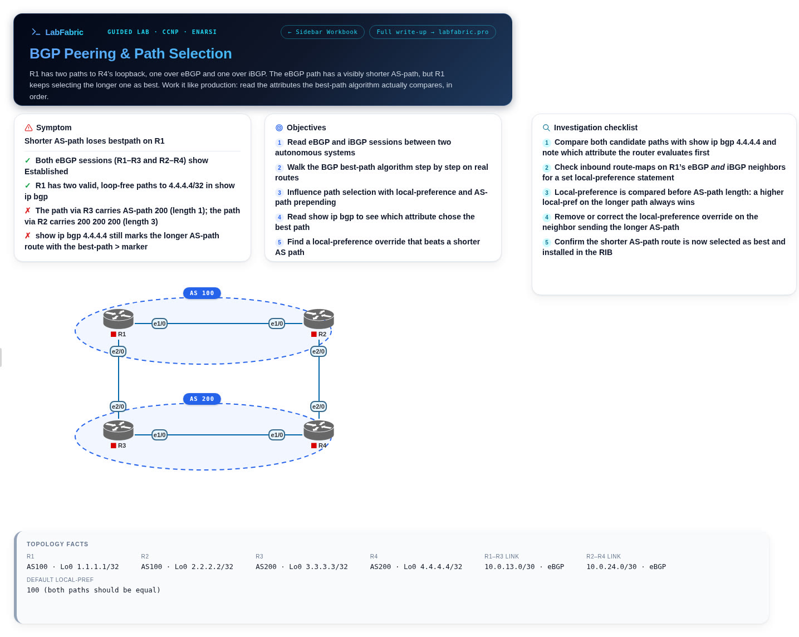

# BGP Peering & Path Selection

Two autonomous systems, two paths to the same prefix, and R1 keeps choosing the one with the longer AS path. Walk the best-path algorithm to the attribute that overrides it.



**[Download the .unl from LabFabric](https://labfabric.pro/free-labs/bgp-peering-path-selection-lab?utm_source=github&utm_medium=referral&utm_campaign=eve-ng-pnetlab-labs)** (48 KB, free, CC BY 4.0)

No lab server? [Practise it in your browser](https://labfabric.pro/guided-labs/bgp-peering-path-selection-lab?utm_source=github&utm_medium=referral&utm_campaign=eve-ng-pnetlab-labs) instead.

## What you'll practise

- Read eBGP and iBGP sessions between two autonomous systems
- Walk the BGP best-path algorithm step by step on real routes
- Influence path selection with local-preference and AS-path prepending
- Read show ip bgp to see which attribute chose the best path
- Find a local-preference override that beats a shorter AS path

## What's in the file

- The topology, with every node and cable in place
- Startup configs with the fault already in them
- Canvas notes: symptom, objectives, investigation checklist and topology facts
- A step-by-step walkthrough workbook

## Node image

The file does not include node images. It expects your own licensed copy of:

- `L3-ADVENTERPRISEK9-M-15.4-2T.bin`

If your copy has a different name, open each node's Edit dialog after importing and pick your image from the list.

## Setup

Replace `<your-server>` with the IP address or hostname of your EVE-NG or PNETLab server.

```bash
scp bgp-peering-path-selection-lab.unl root@<your-server>:/opt/unetlab/labs/
# then, logged in to the server:
/opt/unetlab/wrappers/unl_wrapper -a fixpermissions
```

Open the lab from the lab list and start the nodes.

---

Exam: CCNP · ENARSI · Platform: IOL L3 · [All free labs](https://labfabric.pro/free-labs?utm_source=github&utm_medium=referral&utm_campaign=eve-ng-pnetlab-labs)
