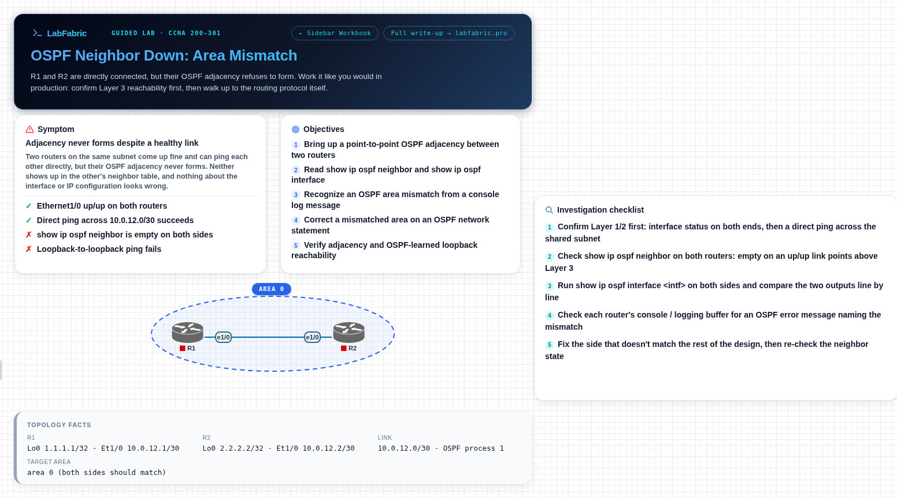

# OSPF Neighbor Down: Area Mismatch

Two routers share a working /30 link, but their OSPF adjacency never forms. Work up from Layer 3 to find out why.



**[Download the .unl from LabFabric](https://labfabric.pro/free-labs/ospf-neighbor-area-mismatch-lab?utm_source=github&utm_medium=referral&utm_campaign=eve-ng-pnetlab-labs)** (51 KB, free, CC BY 4.0)

No lab server? [Practise it in your browser](https://labfabric.pro/guided-labs/ospf-neighbor-area-mismatch-lab?utm_source=github&utm_medium=referral&utm_campaign=eve-ng-pnetlab-labs) instead.

## What you'll practise

- Bring up a point-to-point OSPF adjacency between two routers
- Read show ip ospf neighbor and show ip ospf interface
- Recognize an OSPF area mismatch from a console log message
- Correct a mismatched area on an OSPF network statement
- Verify adjacency and OSPF-learned loopback reachability

## What's in the file

- The topology, with every node and cable in place
- Startup configs with the fault already in them
- Canvas notes: symptom, objectives, investigation checklist and topology facts
- A step-by-step walkthrough workbook

## Node image

The file does not include node images. It expects your own licensed copy of:

- `L3-ADVENTERPRISEK9-M-15.4-2T.bin`

## Setup

Replace `<your-server>` with the IP address or hostname of your EVE-NG or PNETLab server.

```bash
scp ospf-neighbor-area-mismatch-lab.unl root@<your-server>:/opt/unetlab/labs/
# then, logged in to the server:
/opt/unetlab/wrappers/unl_wrapper -a fixpermissions
```

Open the lab from the lab list and start the nodes.

---

Exam: CCNA · 200-301 · Platform: IOL L3 · [All free labs](https://labfabric.pro/free-labs?utm_source=github&utm_medium=referral&utm_campaign=eve-ng-pnetlab-labs)
